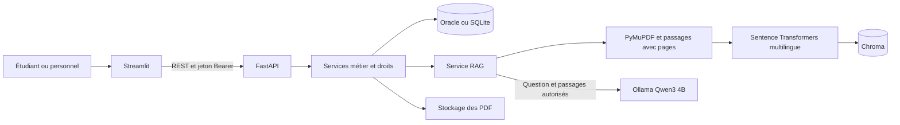

# Architecture de la bibliothèque intelligente

L'interface n'accède pas directement à SQL, Chroma ou aux fichiers PDF. FastAPI authentifie chaque requête et délègue aux services métier. Les documents privés sont filtrés côté serveur avant toute recherche vectorielle, ainsi qu'avant leur téléchargement ou analyse. Le client ne choisit jamais l'identité de l'auteur de ses questions, favoris, collections ou évaluations.

Les inscriptions publiques créent uniquement des comptes étudiants. Le premier administrateur est créé par une commande locale explicite. Les bibliothécaires gèrent le catalogue, l'import des PDF et les emprunts. Les administrateurs gèrent aussi les rôles et consultent les statistiques. Les étudiants réservent, organisent leurs ressources et utilisent l'assistant.

Un emprunt et la vérification de disponibilité sont effectués dans la même transaction. SQLite sérialise les écritures ; Oracle verrouille le livre et les lignes pertinentes avec `FOR UPDATE`. Les retours actualisent la disponibilité et créent une notification pour le premier étudiant ayant réservé. L'historique d'emprunt bloque la suppression d'un livre pour conserver la traçabilité.

La base SQL est la référence des autorisations et états d'indexation. Chroma contient les passages, les vecteurs, l'identifiant documentaire et la page. Une indexation partielle échouée tente de supprimer ses vecteurs ; les documents dont l'état n'est pas `ready` sont exclus des questions. Le changement de modèle d'embeddings sélectionne une nouvelle collection ; il nécessite la réindexation du corpus.

